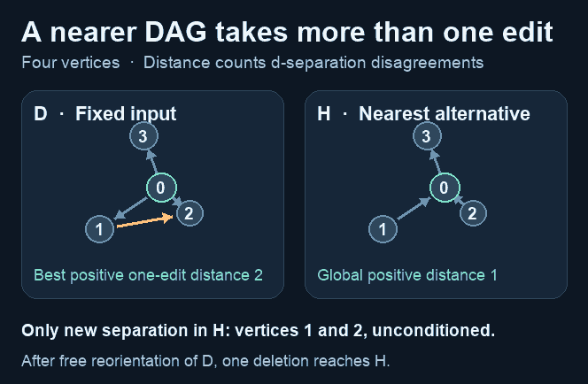

# A four-vertex counterexample for one-arc Bayesian network neighbors

A supplied four-vertex DAG has global minimum positive d-separation distance **1**, while its best positive distance after one arc edit is **2**. The gap extends to every larger size by adding isolated vertices. [Conjecture 2, fixed-input reading](https://raw.githubusercontent.com/mlresearch/v337/main/assets/harviainen26a/harviainen26a.pdf#page=7)

[Paper PDF](paper/manuscript.pdf) · [LaTeX source](paper/manuscript.tex) · [Catalog Q811](https://github.com/10m-u/open-problems-catalog/blob/ca8d4d44ba3db527f19f28928c240168f545ecfe/problems/statistics_data_science/experimental-design-causal-inference.md#q811)

## One new separation

The nearest witness adds only the unconditional separation of vertices 1 and 2. Their path has a collider at 0. Conditioning on 0 or its descendant 3 activates it. In the input the endpoints are adjacent.

[Download the offline explorer ZIP](https://raw.githubusercontent.com/DannyExperiments/four-vertex-one-arc-neighbors/v1.0.0/visualization/four-vertex-one-arc-neighbors-explorer.zip) · [Worked example and rendering guide](visualization/README.md)

## Scope and evidence

From a Markov-equivalent representative $D'$, a single deletion does reach the witness. This leaves the general free-reorientation question outside the counterexample. A Python census verifies the class-level statement on all labelled DAGs through five vertices. An attributed corollary of Chickering’s theorem treats nested signatures. [Exact scope](CLAIM_SCOPE_AND_LIMITATIONS.md) · [Literature audit](audits/public_safe_reports/LITERATURE_AUDIT.md)

[Exact replay](REPRODUCIBILITY.md) checks every query and one-arc edit in the four-vertex witness. The paper includes the analytic extension and finite census scope. Internally reviewed, not peer reviewed. [Technical disclosure](AI_DISCLOSURE.md) · [Review status](STATUS.md)

DannyExperiments is the preferred citation identity. [Release v1.0.0](https://github.com/DannyExperiments/four-vertex-one-arc-neighbors/releases/tag/v1.0.0) · [Version DOI](https://doi.org/10.5281/zenodo.24572566) · [Citation metadata](CITATION.cff)
