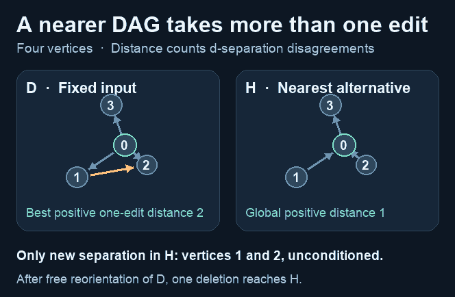

# A nearer DAG takes more than one edit

[Download the offline explorer ZIP](https://raw.githubusercontent.com/DannyExperiments/four-vertex-one-arc-neighbors/v1.0.0/visualization/four-vertex-one-arc-neighbors-explorer.zip). Unpack and open the HTML. Switch among D, H and the Markov-equivalent D′, and rotate any graph. Toggle conditioning on vertices 0 and 3 to see whether the query on vertices 1 and 2 is separated.

The figures use the directed edges of the paper. The sole new separation is at the empty conditioning set. The amber edge from 1 to 2 is present in the fixed input and its equivalent representative. Its deletion reaches H only from the equivalent representative.

Render the GIF using an existing Python environment with Pillow and Arial or DejaVu Sans.

~~~sh
python3 visualization/render.py
~~~
